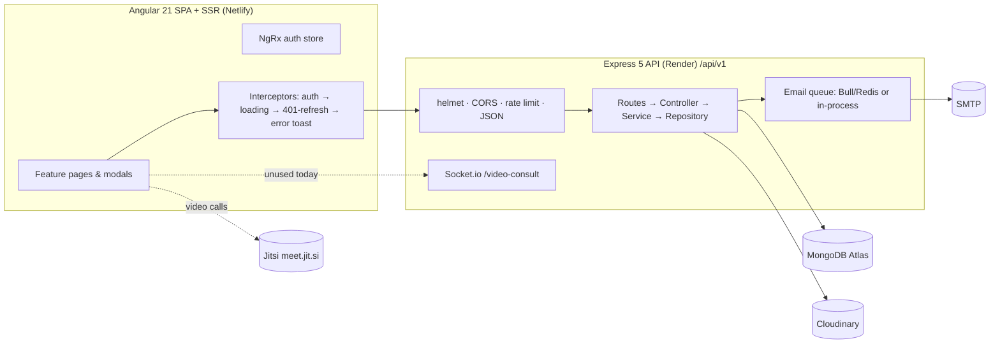
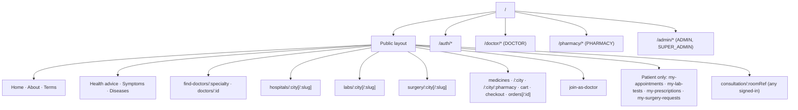
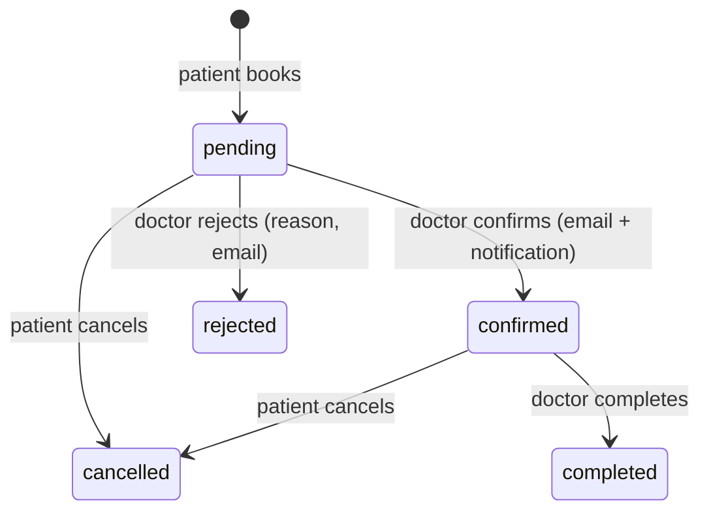
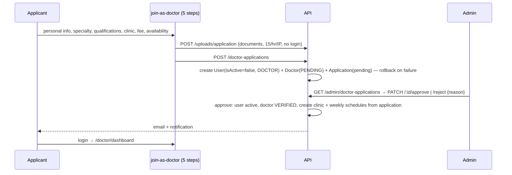
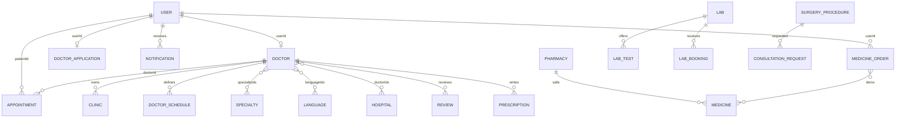

# CareHub — Application Flow

A healthcare marketplace for Pakistan: patients find doctors, book clinic/video appointments, order lab tests and medicines, request surgery consultations, and read/ask health questions. Doctors, pharmacies and admins each have a portal.

> Status: reflects the code as of the `Revamp-structure` branch (Nov 2026). Section 12 lists known gaps found during analysis.

---

## 1. System overview



| Layer | Tech |
|---|---|
| Frontend | Angular 21 (zoneless, standalone, OnPush, signals), NgRx (auth only), Tailwind 4, SSR + hydration |
| Backend | Node ≥ 20, Express 5, Mongoose 8, Zod validation, JWT, bcrypt, Winston |
| Infra | Netlify (web), Render free tier (API), MongoDB Atlas, Cloudinary (files), optional Redis (email queue) |

Local ports: API `5800`, web `4200`. Frontend `environment.ts` points to `http://localhost:5800/api/v1`; production points to the Render URL (overwritten at Netlify build by `scripts/set-env.js`).

---

## 2. Backend architecture

```
src/
├── app.js / server.js        # app factory / entry (Mongo first, then HTTP; Redis+queue in background)
├── config/                   # env, database, redis, swagger
├── routes/index.js           # mounts every module router under /api/v1
├── core/                     # AppError + errorHandler, auth middleware, JWT utils, logger, pagination
├── shared/                   # constants, enums, validate/rate-limit/role/resource-owner middleware,
│                             #   event notifications, memory cache, cloudinary/storage, mappers
├── modules/<name>/           # routes · controller · service · repository · model · validator
├── jobs/                     # email queue + processor
└── sockets/                  # Socket.io with JWT handshake; /video-consult namespace
```

**Request pipeline:** `helmet → CORS → compression → global rate limit (100/15 min/IP) → write limiter (POST/PUT/PATCH/DELETE: 120/15 min) → body parsers (10 MB) → router → validate (Zod) → authenticate/authorize → controller → service → repository → response envelope`.

**Response envelope:** `{ success, message, data }` or `{ success:false, message, errors:[{field,message}] }`.

**Error handling:** services throw `AppError` subclasses (`BadRequest 400`, `Unauthorized 401`, `Forbidden 403`, `NotFound 404`, `Conflict 409`, `Validation 422`); one global handler formats them.

**Caching:** public specialties/languages are cached in-process (~10 min) and sent with `Cache-Control` (5 min, SWR). Public doctor search is HTTP-cached 15 s. Specialty-slug lookups are cached 5 min.

---

## 3. Roles & access

| Role | How it is created | Lands on after login | Can do |
|---|---|---|---|
| `PATIENT` | Self-register (`/auth/register`) | `/` | Book appointments, labs, surgery requests, orders; review doctors; see prescriptions & notifications |
| `DOCTOR` | **Doctor application only** (`POST /doctor-applications`) → admin approval | `/doctor/dashboard` | Manage profile, clinics, schedules, appointments, prescriptions |
| `ADMIN` / `SUPER_ADMIN` | Seeded (`scripts/ensure-admin.js`, `seed.js`) | `/admin/dashboard` | Users, doctor applications, doctor verification, catalog CRUD (hospitals, labs, surgeries, medicines/pharmacies, specialties, languages), order status, surgery requests |
| `PHARMACY` | Seeded / admin-provisioned; linked to a `Pharmacy` via `userId` | `/pharmacy/orders` | View & progress orders containing its items |
| `CLINIC_MANAGER`, `LAB` | Enum exists; `CLINIC_MANAGER` can self-register | `/` | No dedicated portal yet |

Guest (no login) can: browse everything public, place **medicine orders**, create **lab bookings**, send **surgery consultation requests**, ask **health questions**, upload application documents (rate-limited).

---

## 4. Authentication & session flow

```mermaid
sequenceDiagram
  participant U as Browser
  participant A as API
  participant DB as MongoDB
  U->>A: POST /auth/login {email,password}   (20/15min limiter)
  A->>DB: find user, bcrypt.compare, isActive?
  A-->>U: {user, accessToken (15m), refreshToken (30d)}
  Note over U: tokens → localStorage; NgRx stores user; redirect by role
  U->>A: any request + Authorization: Bearer access
  A->>A: verify JWT → check account active (30s cache)
  A-->>U: 401 when expired
  U->>A: POST /auth/refresh {refreshToken}  (interceptor, then retries original call)
  A->>DB: user active? token.tv == user.tokenVersion?
  A-->>U: new access + refresh
  U->>A: POST /auth/logout  → tokenVersion++ (revokes all refresh tokens)
```

- **Register:** validates, rejects `DOCTOR`, hashes password (bcrypt, 12 rounds), sends welcome email, returns tokens.
- **Inactive account:** doctors awaiting approval get a specific message (pending / rejected with reason).
- **Forgot/reset password:** random 32-byte token → stored **hashed** (1 h TTL, one active per user) → emailed link `FRONTEND_URL/auth/reset-password?token=…`. Reset bumps `tokenVersion` (kills sessions). When SMTP is missing, non-production responses include the link for local testing.
- **Change password:** current password required; does not revoke other sessions.
- **Frontend guards:** `authGuard`, `guestGuard` (login/register redirect away if signed in, honouring `returnUrl`), `roleGuard(...)` → `/unauthorized`. A failed refresh clears tokens and sends the user to `/auth/login?returnUrl=…`.

---

## 5. Frontend map



All routes are lazy-loaded. Cross-cutting UI: global top progress bar (any in-flight HTTP request), toast notifications, notification bell (polls `/notifications/me`).

### Admin: `/admin/dashboard`, `/admin/users`, `/admin/doctor-applications`
### Doctor: `/doctor/{dashboard, profile, appointments, schedule, consultations, prescriptions, patients, earnings}`
### Pharmacy: `/pharmacy/orders`, `/pharmacy/orders/:orderId`

---

## 6. Core user journeys

### 6.1 Discover → book a doctor appointment (patient)

```mermaid
sequenceDiagram
  participant P as Patient
  participant FE as Frontend
  participant API
  P->>FE: Home: pick city, specialty, optional name
  FE->>API: GET /doctors/public/search?city&specialtySlug&name&maxFee&sortBy&page
  API-->>FE: verified, active doctors + clinics/hospitals (batched, no N+1)
  P->>FE: Open doctor → GET /doctors/public/:id (+ reviews)
  P->>FE: "Book" → clinic or video modal (login required; guest redirected with returnUrl)
  Note over FE: Time slots come from the doctor profile's default slot list
  FE->>API: POST /appointments {doctorId, scheduledAt, consultationType, patientPhone}
  API->>API: future date? doctor verified? duplicate pending/confirmed? slot already taken?
  API-->>FE: appointment {bookingRef, status: pending}
  API-->>Doctor: in-app notification (+ admins notified)
```

Search filters (URL-synced): `city`, `q`, `maxFee`, `sort` (experience / rating / fee), `page`. Search matches `fullName`/`title`/linked user name (honorifics like "Dr." are stripped).

**Appointment status machine**



- `slotKey` (doctor+time) and `pairKey` (doctor+patient) are unique while an appointment is pending/confirmed and are released on cancel/reject/complete.
- **Video consultation:** `confirmed` appointments expose a room `/consultation/:bookingRef`; the page embeds **Jitsi** (`meet.jit.si`, room `CareHub-<bookingRef>`). The backend Socket.io signaling namespace exists but the UI does not use it.

### 6.2 Review a doctor
`POST /doctors/:id/reviews` (patient) — allowed only after a **completed** appointment with that doctor, one review per doctor (unique index). Create/update/delete recomputes the doctor's `averageRating` and `reviewCount`. Patients edit/delete their own; admins can delete.

### 6.3 Medicines & orders

```mermaid
flowchart LR
  A[Browse pharmacies / medicines] --> B[Cart (client-side, localStorage service)]
  B --> C[Checkout: address, delivery type, payment method, prescriptions upload]
  C -->|POST /medicines/orders (guest or patient)| D{Server validation}
  D -->|medicine active, belongs to pharmacy, stock, price matches, Rx required?| E[Decrement stock per item]
  E --> F[Create order: placed]
  E -.failure.-> G[Roll back stock]
  F --> H[Pharmacy/Admin advances status]
```

Order statuses: `placed → confirmed → preparing → out_for_delivery → delivered`, with `cancelled` allowed from any non-final state. Payment methods are recorded (`cod, card, jazzcash, easypaisa`) but **no payment is processed**. Pharmacy users only see/handle orders containing their items and see totals scoped to their items. Patients see `/medicines/orders/me`; guest orders are viewable by order id.

### 6.4 Lab tests
Browse labs by city → lab detail (tests, prices) → booking modal (choose tests, collection type, date, slot, patient details; guest allowed) → `POST /lab-bookings` (validates tests belong to the lab and collection type; sums price) → status `pending`. Statuses: `pending → confirmed → sample_collected → report_ready`, or `cancelled` (patient can cancel only before sample collection). Patients view `/my-lab-tests`. *There is no API to advance lab-booking status yet (see gaps).*

### 6.5 Surgery consultation requests
Browse surgery hospitals/procedures → booking modal → `POST /surgeries/consultation-requests` (guest or patient). Admin lists them and sets status: `pending → contacted → scheduled → closed`. Patients view `/my-surgery-requests`.

### 6.6 Hospitals
Public city list and detail pages (hospitals link to doctors via `doctorIds`); admin CRUD and doctor assignment.

### 6.7 Health questions
Public "Ask a doctor" modal → `POST /health-questions` (optional login, anonymous by default, ≥ 10 chars) → stored `pending`; answered questions appear on public Health Advice pages (`GET /health-questions/public`); patients see theirs at `/health-questions/me`. There is no endpoint yet for doctors/admins to answer them (answers appear to be seeded).

### 6.8 Notifications
Events create in-app notifications (and emails where noted): appointment booked (doctor + admins), confirmed, rejected, cancelled (patient + doctor), doctor application approved/rejected. Frontend bell lists `GET /notifications/me`, marks read via `PATCH /notifications/:id/read`, and deep-links using `data.link`.

---

## 7. Doctor onboarding & approval



Until approved, login returns "pending approval" (or the rejection reason). Only `VERIFIED` + active doctors appear in public search and can be booked.

---

## 8. Doctor portal flow
- **Dashboard:** counts and upcoming appointments.
- **Profile:** `GET/PATCH /doctors/me` (bio, qualifications, work history, fee, image…). Rating/verification fields are protected server-side.
- **Clinics & Schedule:** `/clinics/me`, `/schedules` (day-of-week or specific date, start/end, slot length, clinic/video type). Ownership is enforced by `requireResourceOwner`.
- **Appointments:** list, confirm, reject (with reason), complete — only for the doctor's own appointments.
- **Prescriptions:** `POST /doctor/prescriptions` for a registered patient (requires a confirmed/completed appointment together) or a free-text patient name; patients read them at `/prescriptions/me`.
- **Patients / Earnings / Consultations:** derived from appointments on the client.

## 9. Admin portal flow
Dashboard stats; user list/search and activate/deactivate (takes effect within ~30 s); doctor application review; doctor verification (`/admin/doctors`); catalog CRUD for hospitals, labs & tests, surgery procedures, pharmacies & medicines, specialties, languages; surgery request triage; order status override.

## 10. Data model (key collections)



`User.tokenVersion` revokes refresh tokens. `Appointment.slotKey/pairKey` are sparse-unique guards. `PasswordResetToken` has a TTL index.

## 11. Cross-cutting behaviour

- **Rate limits:** global 100/15 min, writes 120/15 min, auth endpoints 20/15 min, anonymous upload 15/hr (all per IP, in-memory).
- **Uploads:** PDF/JPG/PNG up to 5 MB (memory → Cloudinary, or local disk when `STORAGE_PROVIDER=local`).
- **Email:** queued through Bull when Redis is on; otherwise sent in-process; without SMTP it is logged only.
- **Frontend loading UX:** global progress bar, skeletons for first loads, in-place dimmed refresh for filter changes, spinners on submit buttons.
- **Config safety:** in production the API refuses to start without JWT secrets, Mongo URI, CORS/frontend URL and Cloudinary keys.

## 12. Known gaps & risks (from this analysis)

1. **Time slots aren't tied to doctor schedules.** Booking modals use a fixed default slot list from the doctor profile mapper; the schedules doctors configure are stored but not used when booking. Booked slots aren't greyed out — a taken slot is rejected with a 409 at submit time.
2. **Dead availability code.** `schedules.controller.getAvailability` has no route and calls a repository function (`findBookedSlotsByDoctorAndDate`) that doesn't exist.
3. **No status workflow for lab bookings** and **no way to answer health questions** — only creation/listing exists.
4. **Payments are not processed** (method is just recorded). Coupon codes are stored but not applied.
5. **Guest medicine orders** can be read by anyone who knows the order id.
6. **Video consult:** Socket.io signaling is built but unused (Jitsi iframe is used instead); the room is just the booking reference.
7. **Pharmacy accounts** have no self-service creation; `LAB` / `CLINIC_MANAGER` roles have no portal.
8. **Change password** doesn't sign out other devices.
9. **In-memory** rate limiter and caches are per-instance (fine for one Render instance; not for scaling out).
10. **Tests:** backend has a small Jest suite (errors, tokens, auth middleware/service); the frontend has only the default spec.
11. **Tokens in `localStorage`** (XSS exposure trade-off with SSR + Bearer auth).
12. **Free-tier cold starts:** the app warms `/health` on page load and ships a `keep-alive` script.

## 13. Running locally

```bash
# backend (needs MongoDB; REDIS_ENABLED=false is fine)
cd CareHub-Backend && cp .env.example .env && npm install && npm run dev     # :5800
# optional sample data (check the script before running against real data)
npm run seed
# frontend
cd CareHub-frontend && npm install && npm start                               # :4200
```

Dev accounts created for testing: `patient@carehub.test`, `doctor@carehub.test`, `admin@carehub.test` — password `Password123!`.
